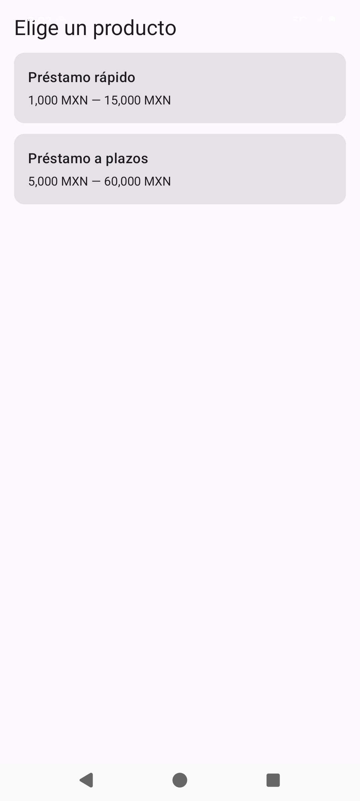
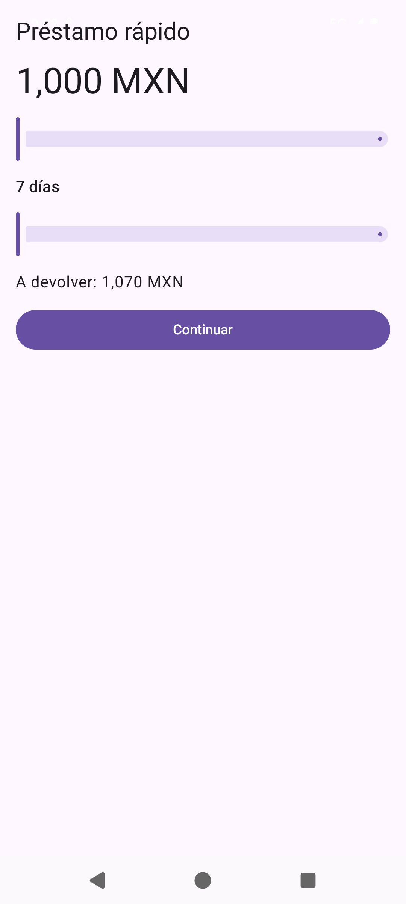
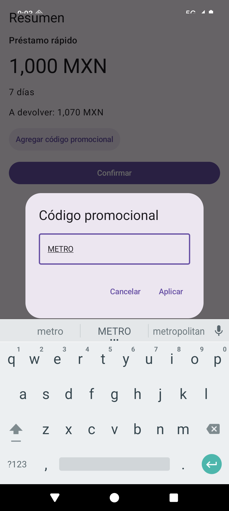
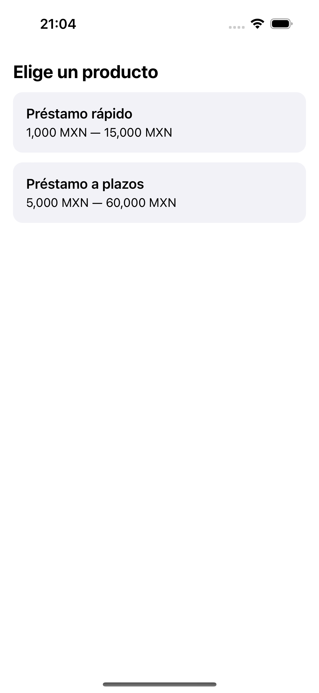
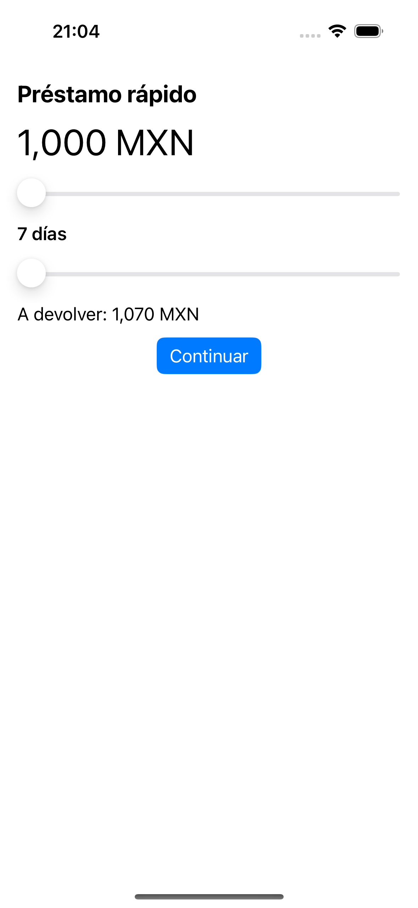
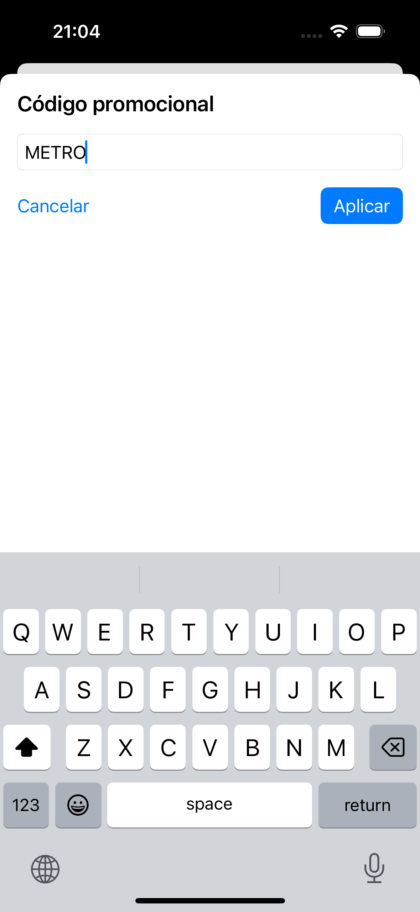
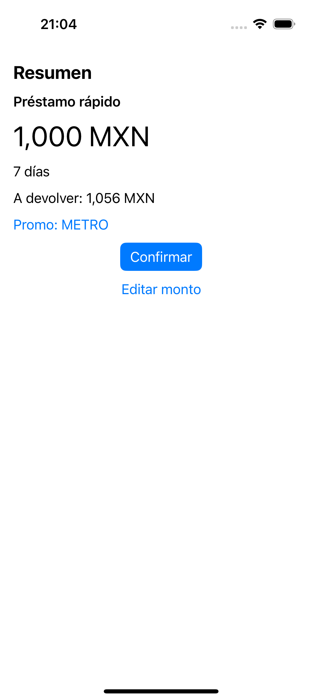
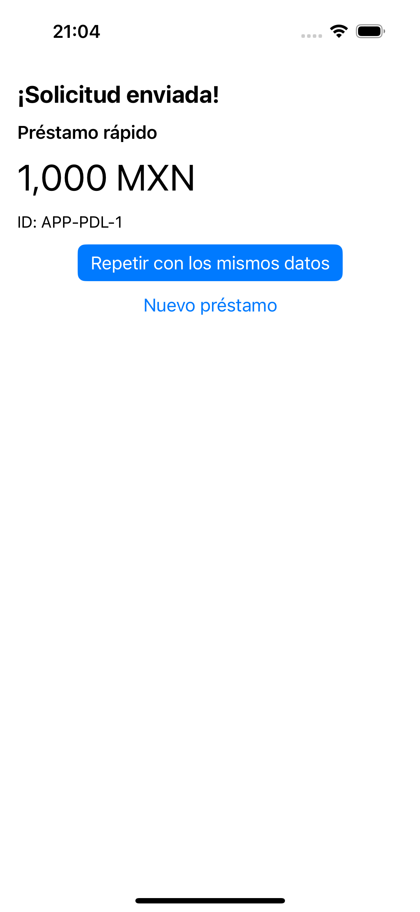

# metro-loan-demo

A small Kotlin Multiplatform app built for one purpose: to evaluate
**[Metro DI](https://zacsweers.github.io/metro/)** on a production-style mobile architecture.
The app itself is a four-screen loan calculator with fake data. What matters is the shape of the
project around it: many Gradle modules, one feature per module pair, shared
[Decompose](https://arkivanov.github.io/Decompose/) components, Compose on Android and native
SwiftUI on iOS.

The question the repo answers: does a compile-time DI framework fit this layout, and what breaks
along the way? The answers are in [Findings](#findings) and, in full, in [PLAN.md](PLAN.md).

## What the app does

| Screen | Purpose |
| --- | --- |
| Product list | Pick one of two fake loan products. |
| Calculator | Choose an amount and a term with sliders; the total to repay updates live. |
| Summary | Review the draft, optionally apply a promo code (`METRO` gives 20%, `KOIN` gives 5%), confirm. |
| Result | Shows the application id. Start over, or repeat with the same data prefilled. |

Data never leaves the device: repositories are in-memory fakes with a short `delay()` to mimic
network latency.

### Screenshots

Captured by the [Maestro](https://maestro.mobile.dev/) flows in [`.maestro/`](.maestro) on an
Android emulator and an iOS simulator.

| Product list | Calculator | Summary | Promo dialog |
| --- | --- | --- | --- |
|  |  |  |  |

| Summary with promo | Result | Calculator prefilled |
| --- | --- | --- |
|  |  |  |

iOS, same flow, same shared components:

| Product list | Calculator | Summary | Promo dialog |
| --- | --- | --- | --- |
|  |  |  |  |

| Summary with promo | Result | Calculator prefilled |
| --- | --- | --- |
|  |  |  |

## How it works

### Module layout

```
build-logic/convention      demo.kmp convention plugin (KMP targets, Android library config)
core/common                 LoanDraft, Platform, MoneyFormatter, AnalyticsSink, componentScope()
core/data                   repository interfaces + in-memory fakes, two @Named KeyValueStorage
core/domain                 use cases
feature/<name>/components   Decompose component contract + implementation + its screen graph
feature/<name>/ui           Compose Multiplatform screen for that component
shared                      RootComponent, AppGraph, the iOS framework (no Compose)
androidApp                  Compose host
iosApp                      SwiftUI host (Xcode project)
```

Dependency rules:

- features never depend on each other; each exposes an `Output` interface and the root component
  decides where to go
- `feature/*/ui` depends only on its own `components`
- `shared` is Compose-free so the iOS framework does not drag Compose in
- iOS consumes `*/components` through the framework and never `*/ui`

### Navigation

```
ProductList ──productId──▶ Calculator ──LoanDraft──▶ Summary ──applicationId+draft──▶ Result
                              ▲                         │ childSlot: promo dialog
                              └── edited draft back ─────┘   (code + discount back via callback)

Result: [Nuevo préstamo] → replaceAll(ProductList)
        [Repetir]        → replaceAll(ProductList, Calculator(prefill = draft))
```

`LoanDraft` is the value that travels between screens. It lives in `core/common` because the
features cannot see each other; [`DefaultRootComponent`](shared/src/commonMain/kotlin/dev/metrodemo/shared/DefaultRootComponent.kt)
routes it. Every direction is covered: forward with a parameter, backward with an edited value
(Summary → Calculator), and a nested dialog returning a result to its parent.

### Dependency injection

Six files tell the whole DI story. Read them in order.

| File | What it demonstrates |
| --- | --- |
| [AppGraph.kt](shared/src/commonMain/kotlin/dev/metrodemo/shared/di/AppGraph.kt) | The one app-wide graph. It lists no modules, no bindings and no screen graphs: everything arrives through Metro's compile-time aggregation. |
| [FakeProductsRepository.kt](core/data/src/commonMain/kotlin/dev/metrodemo/core/data/FakeProductsRepository.kt) | `@ContributesBinding` reaches `AppGraph` across a module boundary without being named anywhere. |
| [StorageBindings.kt](core/data/src/commonMain/kotlin/dev/metrodemo/core/data/storage/StorageBindings.kt) | `@BindingContainer` with two `@Named` implementations of one interface. |
| [ProductListGraph.kt](feature/product-list/components/src/commonMain/kotlin/dev/metrodemo/feature/productlist/ProductListGraph.kt) | The per-screen graph: `@GraphExtension` plus `@ContributesTo(AppScope)` on its factory, with `@Provides` runtime inputs. |
| [SummaryGraph.kt](feature/summary/components/src/commonMain/kotlin/dev/metrodemo/feature/summary/SummaryGraph.kt) | A graph extension of a graph extension: the promo dialog graph hangs off the Summary graph. |
| [DefaultRootComponent.kt](shared/src/commonMain/kotlin/dev/metrodemo/shared/DefaultRootComponent.kt) | The only holder of the graph: `asContribution<X.Factory>()` per screen, plus all the navigation. |

Supporting pieces: [SubmitApplicationUseCase.kt](core/domain/src/commonMain/kotlin/dev/metrodemo/core/domain/SubmitApplicationUseCase.kt)
injects a `Set<AnalyticsSink>` whose two contributors live in different modules;
[AppGraphAccessors.kt](shared/src/commonMain/kotlin/dev/metrodemo/shared/di/AppGraphAccessors.kt)
is the typed entry point for both platforms; [IosEntry.kt](shared/src/iosMain/kotlin/dev/metrodemo/shared/di/IosEntry.kt)
is the single function Swift calls, so there is no `get<T>()` on the Swift side to mistype.
[TestGraph.kt](feature/calculator/components/src/commonTest/kotlin/dev/metrodemo/feature/calculator/TestGraph.kt)
shows how a test swaps a binding with `replaces`.

### iOS

The Xcode project embeds the `Shared` framework directly (a build phase runs
`:shared:embedAndSignAppleFrameworkForXcode`, no CocoaPods). Swift calls one Kotlin function,
`createIosRootComponent()`, and gets back the root component. Each SwiftUI view subscribes to its own
component's `Value<Model>` through the small `StateValue` property wrapper in
[`ObservableValue.swift`](iosApp/iosApp/internal/ObservableValue.swift), the SwiftUI counterpart of
`subscribeAsState()` in Compose.

## Versions

| | |
| --- | --- |
| Kotlin | 2.3.21 |
| Metro | 1.1.1 |
| Compose Multiplatform | 1.9.3 |
| Decompose / Essenty | 3.2.2 / 2.5.0 |
| Gradle | 8.13 |

Metro is pinned to 1.1.1 rather than the newest release on purpose. From 1.2.0 on, Metro's
Kotlin/Native runtime klib is built with Kotlin 2.4.0, which a 2.3.21 Kotlin/Native compiler cannot
read. Android builds fine on newer Metro; the limit is iOS only. The annotation surface of 1.1.1 is
identical to 1.4.0 for everything used here. The branch `experiment/kotlin-2.4` has a green build on
Kotlin 2.4.10 + Metro 1.4.0.

## Running

Android:

```bash
./gradlew :androidApp:installDebug
```

iOS: open `iosApp/iosApp.xcodeproj` and run the `iosApp` scheme, or headlessly:

```bash
xcodebuild -project iosApp/iosApp.xcodeproj -scheme iosApp -destination 'platform=iOS Simulator,name=iPhone 16 Pro' build
```

Tests (the `replaces` test graph):

```bash
./gradlew :feature:calculator:components:testDebugUnitTest
```

UI flows with Maestro, against a running emulator or simulator with the app installed:

```bash
maestro test .maestro/loan_flow_android.yaml
```

```bash
maestro test .maestro/loan_flow_ios.yaml
```

Each flow walks all four screens, applies the `METRO` promo code, submits and repeats with prefilled
data. Maestro 2.x writes `takeScreenshot` files into its own run directory,
`~/.maestro/tests/<run>/<flow>/takeScreenshot/docs/screenshots/...`; the images in
`docs/screenshots/` are copied from there.

## Findings

The short version. The numbered journal with evidence is in [PLAN.md](PLAN.md#7-журнал-находок)
(Russian).

- **Cross-module aggregation works as advertised.** `shared` contains no reference to any feature or
  data module, yet every binding and screen graph lands on `AppGraph`, and a missing binding is a
  compile error with a readable message instead of a runtime exception.
- **Every pattern from a Koin-based codebase has a direct Metro equivalent**: scoped per-screen
  graphs, parameterised factories, qualified bindings, multibindings, nested dialog scopes, a typed
  entry point for Swift.
- **Decompose components need an explicit `binding<T>()`** on `@ContributesBinding`, because
  `ComponentContext by componentContext` makes the context interface a supertype too.
- **Metro graphs have no `close()`.** Anything with a lifetime is tied to the Decompose lifecycle by
  hand (`componentScope()`).
- **Metro 1.2.0+ does not work on Kotlin 2.3.21 for iOS.** Metro's compatibility table describes the
  compiler plugin, not the ABI of the Kotlin/Native runtime klib. Keeping up with Metro means keeping
  Kotlin current almost release for release.
- **A Metro 1.1.1 bug:** `asContribution<T>()` is silently left untransformed when its receiver is an
  inline chain containing `createGraphFactory<T>()`, and throws `UnsupportedOperationException` at
  runtime. Assigning the graph to a local first works. Reproduced in the calculator test.
- **The Metro Gradle plugin cannot be applied from a precompiled script plugin on Gradle 8.13** (its
  jar is built with a newer Kotlin than the embedded kotlin-dsl compiler accepts), so it is applied
  per module with `alias(libs.plugins.metro)`. It also requires a Java 21 toolchain for `build-logic`.
- **Incremental builds:** `shared`, where `AppGraph` is generated, recompiles on any change below the
  feature level. On twelve modules that is one to two seconds; this project is too small to predict
  the cost on a graph with hundreds of bindings.
